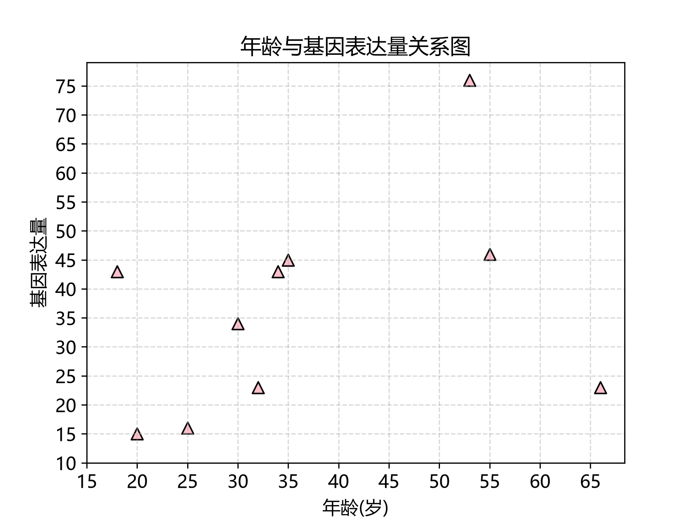

## BME 生物医学工程小demo

## 1.Project Overview (项目概述)
本项目是针对**生物医学工程 (BME)** 与医疗数据处理方向的基础实战 Demo。
旨在模拟真实医疗信息系统（HIS）中的底层逻辑，通过编写自动化脚本，对患者的生理参数（体温、心率）进行批量处理与异常预警，并实现异常数据的持久化导出。

## Core Features (核心功能)
- **外部数据接口**：利用 `Pandas` 动态读取外部 CSV 文件，实现代码与数据的解耦。
- **多条件逻辑筛查**：封装 `analyze_vitals` 核心函数，遍历患者数据，通过多条件判断（体温>=37.5℃ 或 心率>=100 bpm）精准识别异常体征。
- **自动化报告生成**：利用 Pandas 高级布尔索引，瞬间筛选出异常患者数据，并自动导出为带编码保护的 CSV 报告 (abnormal_report.csv)。

## Tech Stack (技术栈)
- **Language**: Python 3.x
- **Library**: Pandas (Data Processing)

## Quick Start (快速开始)
1. 确保本地环境已安装 Pandas: `pip install pandas`
2. 运行脚本：
```bash
python yourself.py
 ```
## 2. Data Visualization (数据可视化)
- 在完成数据筛查后，使用 `Matplotlib` 绘制了“年龄与基因表达量”的散点图。
- 运用了 `marker='^'` (三角形)、`edgecolors='black'` (黑边) 自定义图表样式。
- 通过 `plt.xticks` 和 `plt.yticks` 精确控制了坐标轴刻度，并保存为 300dpi 高清科研级图像。




*这是我第一个小项目哦～ヽ(*≧ω≦)ﾉ*
